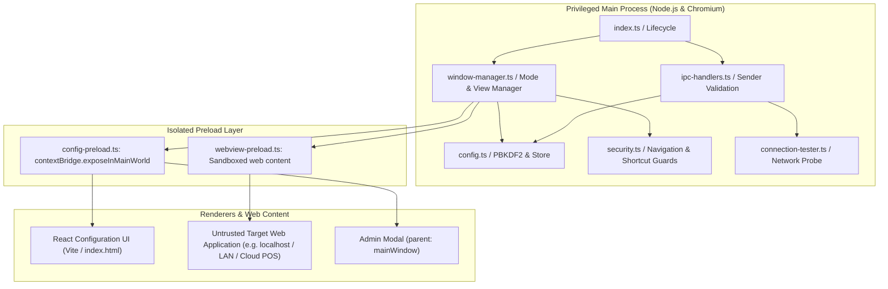
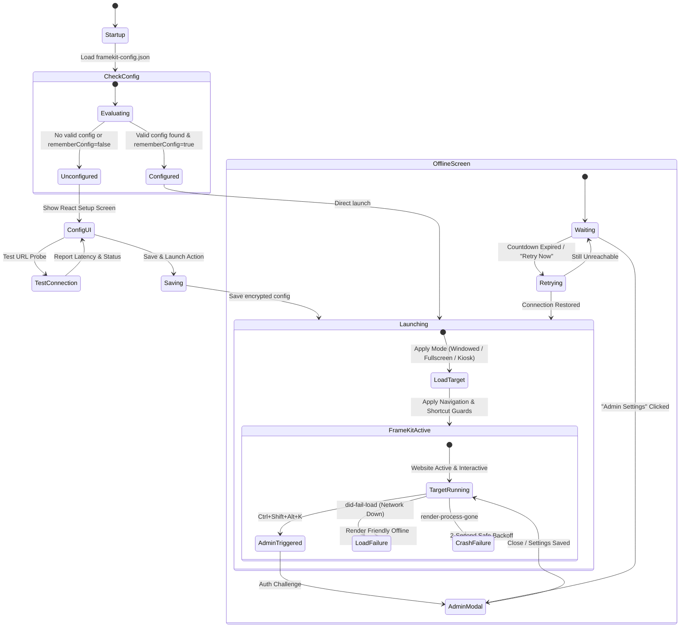

# Architecture & System Design

This document details the internal architecture, process boundaries, security isolation, and lifecycle transitions of the **FrameKit**.

---

## 1. System Overview

FrameKit uses a three-tier decoupled architecture:
1. **Electron Main Process**: Privileged Node.js environment managing native OS windows, application lifecycle, network probes, configuration storage, and Chromium security policies.
2. **Preload Context Bridges**: Strictly isolated mediator scripts (`config-preload.ts` and `webview-preload.ts`) using `contextBridge` to expose only safe, typed methods to local UI without exposing Node.js primitives.
3. **React Configuration & Diagnostics Renderer**: Unprivileged, modern UI bundled with Vite, responsible for administrator setup, connection diagnostics, and offline fallback views.

---

## 2. Process Separation & Security Isolation

### A. Main Process (`src/main/`)
The main process acts as the security supervisor:
- **`index.ts`**: Enforces `app.requestSingleInstanceLock()`. If a secondary instance is launched, it restores and focuses the active window and immediately terminates the duplicate.
- **`config.ts`**: Manages persistent storage at `app.getPath('userData')/framekit-config.json`. Password hashes are generated via Node's `crypto.pbkdf2Sync` (100,000 iterations of SHA-512 with a 32-byte cryptographically secure random salt). Never stores plain passwords. Enforces an `AdminRateLimiter` that locks access after 5 consecutive failed attempts.
- **`security.ts`**: Intercepts Chromium navigation events (`will-navigate`, `will-redirect`), popup creation (`setWindowOpenHandler`), `<webview>` attachment (`will-attach-webview`), context menus, and keyboard input (`before-input-event`).
- **`window-manager.ts`**: Creates and configures the native `BrowserWindow`. Applies launch modes (`windowed`, `fullscreen`, `kiosk`), handles crash recovery, and orchestrates offline fallback transitions.
- **`ipc-handlers.ts`**: Registers typed IPC invoke handlers. Every invocation passes through `isTrustedSender()`, verifying that the requesting frame origin is an internal `file://` or local dev URL. Any IPC request from an external web application is rejected immediately.

### B. Preload Scripts (`src/preload/`)
- **`config-preload.ts`**: Attached exclusively to the local configuration and admin interface. Exposes `window.lockdownAPI` using `contextBridge.exposeInMainWorld()`. Does not leak `ipcRenderer` directly.
- **`webview-preload.ts`**: Attached to external or untrusted target web applications. Contains zero privileged IPC bridges and neutralizes `window.opener` references.

### C. Renderer UI (`src/renderer/`)
Built with React 19, TypeScript, and Vite:
- **`ConfigForm.tsx`**: Validates URLs in real-time, displays classification badges (Local vs. Public, HTTP vs. HTTPS), and runs connection probes.
- **`AdminModal.tsx`**: Isolated administrator control dialog opened via `Ctrl+Shift+Alt+K` or button click.
- **`OfflineView.tsx`**: Polished connection failure view displaying target URL, error code, live reconnect countdown, manual retry button, and admin unlock trigger.

---

## 3. Application Lifecycle & State Transitions

The application operates according to the following deterministic state machine:

---

## 4. Crash Recovery & Resilience

To prevent infinite reload loops and resource thrashing when a network drops or a web application crashes:
1. **Renderer Crash Isolation**: `mainWindow.webContents.on('render-process-gone')` detects abnormal termination. Instead of an immediate restart that could freeze the OS in an infinite loop, the system logs the incident, applies a 2-second backoff delay, and switches the view to the local offline screen.
2. **Network Offline Backoff**: When `did-fail-load` triggers on the main frame, the URL and failure code (e.g. `ERR_CONNECTION_REFUSED`, `ERR_NAME_NOT_RESOLVED`) are passed into the local offline view. A 15-second countdown timer runs between automatic reconnection attempts, and manual retry is debounced.
3. **Session Preservation**: Web storage (`localStorage`, `sessionStorage`, `IndexedDB`) and HTTP session cookies are preserved inside the partitioned Electron user profile directory, ensuring that cashier or operator logins survive window reloads and network reconnects.

---

## FrameKit Identity & Platform Architecture

FrameKit is built on strict design and architectural standards:
- **Design System**: Square corners, flat surfaces, thin 1px borders, Inter typography, and a lightweight custom SVG icon system.
- **Frontend**: React + TypeScript, using shared modular UI primitives.
- **Desktop Engine**: Electron for Windows and macOS with main-process boundary isolation.
- **Mobile Engine**: Capacitor with native Android WebView and Lock Task Mode pinning.
- **Display Modes**: Standard (Framed Desktop Window), Fullscreen (Edge-to-edge), and Kiosk (Hardware locked).
- **Network Support**: Localhost development, private LAN IP addresses, and public HTTPS domains with TLS validation.
- **Distribution Packages**: Windows NSIS installer (`.exe`), macOS application (`.dmg` / `.zip`), and Android APK/AAB.
